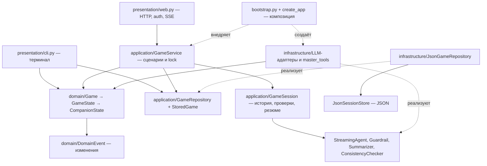

# Архитектура Fable

Fable разделяет правила кампании, сценарии приложения и технические адаптеры.
Это небольшой модульный монолит, а не набор микросервисов: границы ниже помогают
объяснять ответственность кода, но не требуют отдельных процессов или баз данных.
Домен не зависит от FastAPI, LangChain и файловой системы.

## Единый язык

| Термин | Значение |
| --- | --- |
| Игра / кампания | Одна история с неизменяемыми настройками, текущим состоянием мира и повествовательной сессией. Идентифицируется `Game.id`. |
| Мастер | Агент, который описывает сцены и оркестрирует инструменты; не принимает важные решения за героя. |
| Герой | Единственный персонаж игрока; профиль `Character` задаёт имя, роль, цель, описание и жанр. |
| Спутник | Персонаж с постоянным профилем `Companion` и изменяемым состоянием `CompanionState`: отношение, присутствие, личные знания. |
| Ход | Действие игрока и завершённый ответ мастера. Начальная сцена генерируется отдельно и не входит в счётчик ходов. |
| Состояние мира | `GameState`: текущая локация, инвентарь героя, подтверждённые факты, состояния спутников. Не полный текст рассказа. |
| Факт | Уже установленное обстоятельство мира, а не план, предположение или обещание мастера. |
| История | Полная последовательность сообщений игрока и мастера, включая метаданные проверки и событий. |
| Резюме | Сжатое изложение старых сообщений для контекста модели. Полная история остаётся в сохранении. |
| Вердикт согласованности | `ConsistencyVerdict`: согласован ли ответ с контекстом; замечания направляются мастеру на следующем ходе. Отрицательный вердикт не отменяет ход. |
| Доменное событие | Неизменяемое описание реально произошедшего изменения состояния. Не команда, не текстовый токен модели и не запись в векторной памяти. |
| Проверка безопасности | Проверка исходных настроек или действия. Блокировка действия не добавляет его в историю. |
| Сохранение | Агрегат игры и снимок повествовательной сессии, записанные атомарной заменой одного JSON-файла. |

## Ограниченные контексты

| Контекст | Модули и граница |
| --- | --- |
| Игровой процесс | `domain/game.py`, `state.py`, `events.py`; сценарии — `application/game_service.py`. Владеет кампанией и завершением хода. |
| Персонажи / спутники | `domain/models.py`, `companion.py`; порт голоса — `application/companions.py`, адаптер — `infrastructure/companion_agent.py`. Состояние спутника входит в кампанию, это не отдельный сохраняемый агрегат. |
| Повествовательная память | `application/session.py`, `summary.py`, `consistency.py`, `prompts.py`; JSON-история, LLM-резюме и проверка, `infrastructure/chroma_memory.py`. Векторные воспоминания отделены от подтверждённых фактов мира. |
| Безопасность | `domain/safety.py`, `application/guardrails.py`, `infrastructure/llm_moderator.py`. Решение о допустимости отделено от генерации сцены. |
| Пользователи | `domain/user.py`, `application/auth.py`, `infrastructure/auth_store.py`, `security.py`, `presentation/auth.py`. Аутентификация, cookie, изоляция сохранений; не правила сюжета. |

Контексты пока связаны прямыми вызовами Python. События служат объяснимой лентой
изменений для игрока, а не распределённой шиной сообщений или event sourcing.

## Агрегат, сущности и объекты-значения

- **Корень агрегата `Game`** (`domain/game.py`): `id`, `owner_id`, `setup`, `state`,
  `created_at`, `updated_at`. `Game.create(id, owner_id, setup, now)` проверяет
  настройки и создаёт начальные состояния спутников. `owner_id=None` допустим для
  CLI и старых файлов. `pull_events()` забирает и очищает события вложенного состояния.
- **Сущность состояния мира `GameState`** (`domain/state.py`): изменения только
  через `update()`, получение спутника через `companion(name)`. Пустые значения не
  добавляются; предметы и факты не дублируются без учёта регистра. Удаление предмета
  имеет приоритет над добавлением в одном вызове. Повтор той же локации не событие.
  `restore()` восстанавливает снимок на том же объекте и очищает события: инструменты
  и провайдер контекста удерживают ссылку на него.
- **Сущность `CompanionState`** (`domain/companion.py`): идентифицируется именем
  внутри кампании. `change_attitude()` ограничивает шаг до ±25; итог в диапазоне
  −100…100. `remember()` убирает пробелы, не добавляет пустые/повторные заметки,
  хранит последние 20. `set_present()` фиксирует уход/возвращение. Загрузка личных
  знаний из файла не создаёт событий.
- **Объекты-значения `GameSetup`, `Character`, `Companion`, `Attitude`**:
  неизменяемые dataclass. Настройки разрешают до трёх спутников; имя непустое, до
  40 символов, уникальное без учёта регистра и отличное от имени героя; роль до
  80, характер до 1000 символов. `Attitude` задаёт число и русскую метку отношения.
- **Объекты-значения `ConsistencyVerdict`, `SafetyVerdict`, доменные события**:
  неизменяемые результаты проверок и описания изменений.
- **`User`** — отдельная идентичность контекста пользователей, не дочерняя
  сущность кампании. Каталоги пользователей выбираются доверенным адаптером.

`GameSession` не является доменной сущностью: это прикладная повествовательная
сессия с агентом, историей, резюме и проверками. `LoadedGame` связывает агрегат,
живую сессию и process-local lock; `StoredGame` — сохраняемый конверт агрегата
и снимка сессии. Так агент и история не проникают в чистую модель мира.

## Доменные события

Все классы находятся в `domain/events.py`, наследуют `DomainEvent`, заморожены и
предоставляют `type`, русское `describe()` и `to_dict()`.

| Класс | `type` | Дополнительные поля JSON | Условие |
| --- | --- | --- | --- |
| `LocationChanged` | `location_changed` | `location` | Изменилась непустая локация |
| `ItemAcquired` | `item_acquired` | `item` | Добавлен новый предмет |
| `ItemLost` | `item_lost` | `item` | Удалён имевшийся предмет |
| `FactEstablished` | `fact_established` | `fact` | Установлен новый факт |
| `CompanionAttitudeChanged` | `companion_attitude_changed` | `companion`, `delta`, `value`, `label` | Изменилось итоговое число отношения; `delta` — фактическая разница |
| `CompanionLearned` | `companion_learned` | `companion`, `note` | Добавлена новая личная заметка |
| `CompanionLeft` | `companion_left` | `companion` | Присутствие сменилось с true на false |
| `CompanionReturned` | `companion_returned` | `companion` | Присутствие сменилось с false на true |

Общие поля JSON: `type` и `text`. Нулевой шаг, достижение границы отношения,
дубли и другие no-op не создают событий. Буферы не входят в `state.to_dict()`;
после успешной генерации сервис забирает события и прикрепляет непустой список
к последнему ответу мастера **до сохранения**. Сбор идёт сначала из мира, затем
из состояний спутников в порядке профилей; это не глобальные временные метки.

API сохраняет прежние поля и добавляет:

- SSE `done`: `events: [{"type": "…", "text": "…", …}]` **всегда**, в том числе `[]`.
- `GET /api/games/{id}`: у ответа мастера в `entries[]` есть `events`, только если
  список непуст. Исторические записи без этого поля остаются допустимыми.

## Порты и адаптеры

| Порт / граница | Реализация / адаптер |
| --- | --- |
| `GameRepository` (`application/ports.py`) | `JsonGameRepository` (`infrastructure/game_repository.py`) поверх `JsonSessionStore`: `get`, `add`, `save`, `delete`, `list_summaries` |
| `StreamingAgent` (`application/ports.py`; переэкспорт в `session.py`) | `GameMasterAgent` (`infrastructure/master_agent.py`), LangChain/LangGraph и OpenAI-совместимый сервер |
| `Guardrail` (`application/guardrails.py`) | `RuleGuardrail`, `CompositeGuardrail`, `LLMModerator` |
| `Summarizer` (`application/summary.py`) | `LLMSummarizer` |
| `ConsistencyChecker` (`application/consistency.py`) | `LLMConsistencyChecker` |
| `CompanionVoice` (`application/companions.py`) | `LLMCompanionVoice` |
| `StoryMemory` (`application/ports.py`; переэкспорт в `master_tools.py`) | `ChromaMemory` |
| `AuthStore` (`application/auth.py`) | `SqliteAuthStore` |
| Фабрики репозитория и сессии, нормализация настроек, часы, генератор id | Внедряются в `GameService`; HTTP-композиция в `create_app`, создание LLM-компонентов в `bootstrap.py` |
| Входной HTTP-адаптер | `presentation/web.py`: HTTP-модели, коды ошибок, сериализация SSE, auth и static mount |
| Входной CLI-адаптер | `presentation/cli.py`: интерактивный UX, тот же агрегат и репозиторий в корне каталога сохранений |

`application/ports.py` также переэкспортирует `Guardrail`, `Summarizer`,
`ConsistencyChecker`, `CompanionVoice`; старые пути импорта остаются рабочими.
Репозиторий возвращает `StoredGame | None`, не создаёт LLM-сессию при чтении и
сохраняет прежнюю структуру файла с добавлением необязательного `owner_id`.
Старые файлы без владельца/спутников читаются через `parse_game_record`;
если профили спутников есть, но состояния ещё нет, оно инициализируется из профилей.
Веб использует `SESSIONS_PATH/<user_id>`, CLI — корень. Проверки безопасного id и
символических ссылок, атомарная запись остались в `JsonSessionStore`.

## Прикладной сервис

Публичный API `GameService`:

```python
create_game(owner: str | None, setup: GameSetup) -> LoadedGame
list_games(owner: str | None) -> list[dict]
get_game(owner: str | None, game_id: str) -> LoadedGame
delete_game(owner: str | None, game_id: str) -> None
start_stream(owner: str | None, game_id: str) -> TurnStream
play_turn_stream(owner: str | None, game_id: str, action: str) -> TurnStream
```

Ошибки приложения не знают HTTP: `GameNotFound`, `GameBusy`,
`GameAlreadyStarted`, `GameNotStarted`, `SetupRejected`, `InvalidSetup`,
`InvalidAction`. Веб-адаптер отображает их в прежние 404/409/422 и русские сообщения.
Поток выдаёт `Chunk`, `TurnCompleted`, `TurnBlocked`, `TurnFailed`, а не SSE-строки.
`TurnStream` нужно исчерпать либо закрыть (`close()` или контекстный менеджер).

CLI намеренно сохраняет собственный интерактивный цикл и прежние сообщения об
ошибках: использует агрегат и репозиторий, но не подменяет терминальный UX
веб-сценарием `TurnFailed`. Общее создание агента остаётся в `bootstrap.py`.

## Жизненный цикл хода

1. HTTP-адаптер проверяет cookie и получает пользователя. Сервис загружает игру
   только из его репозитория; восстановление кэша синхронизировано.
2. Сервис неблокирующе берёт lock конкретной игры. Конкурирующая генерация или
   удаление дают `GameBusy`. Проверка начата/не начата выполняется под этим lock.
3. Сохраняются снимки сессии, состояния мира и предыдущий `updated_at`.
4. Для действия сессия проверяет безопасность до записи в историю. При необходимости
   сжимает старые сообщения. Агент получает обычные role/content сообщения,
   не метаданные событий, и постоянный контекст.
5. Мастер генерирует текст и вызывает инструменты. Они изменяют мир только через
   `GameState.update` и методы `CompanionState`; доменные правила и события не
   дублируются в инструментах или HTTP-обработчиках. Куски текста сразу выдаются
   как `Chunk`, а HTTP-адаптер превращает их в SSE `chunk`.
6. После полного ответа сессия проверяет согласованность и записывает ответ.
   Сбой проверки не обрушает ход; отрицательный вердикт создаёт замечание для
   следующего запроса. Резюме и полный снимок истории сохраняются вместе.
7. Сервис забирает события агрегата, прикрепляет непустой список к ответу,
   обновляет время и сохраняет агрегат со снимком сессии через репозиторий.
8. Только после успешного сохранения выдаётся `TurnCompleted`; HTTP формирует
   `done` с вердиктом, состоянием, резюме и обязательным массивом событий.
9. При блокировке выдаётся `TurnBlocked`; при ошибке агента/сохранения — `TurnFailed`.
   При неуспехе или отмене восстанавливаются состояние на прежней ссылке,
   сессия, время; накопленные события отбрасываются. Успешно сохранённый ход не
   отменяется, если клиент отключился уже во время отправки `done`.
10. В `finally` закрывается генератор и освобождается lock. `GameStreamResponse`
    делает shielded cleanup и закрывает `TurnStream` даже при обрыве до первого
    чанка; освобождение идемпотентно, включая закрытие ещё не запущенного генератора.

## Слои и зависимости



## Границы гарантий

Блокировки и кэш — в памяти одного backend-процесса. Межпроцессной транзакции,
событийной шины, outbox и распределённого lock нет. Отдельные вызовы векторной
памяти не входят в откат JSON-состояния/истории; это прежнее ограничение.
`GameSession` по-прежнему владеет алгоритмами резюме и согласованности, а
существующие функции `build_game_record` / `parse_game_record` сохранены для
совместимости. Проверки не требуют живого LLM: используются fake-агенты,
временные хранилища, сервисные unit-тесты и ASGI-тесты отмены потока.
